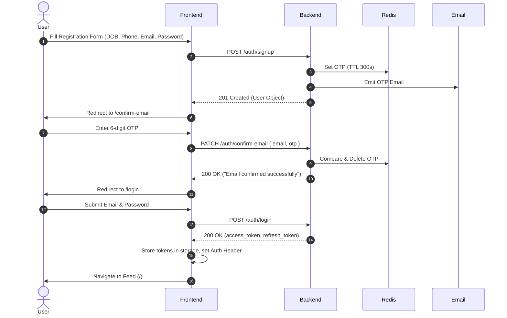
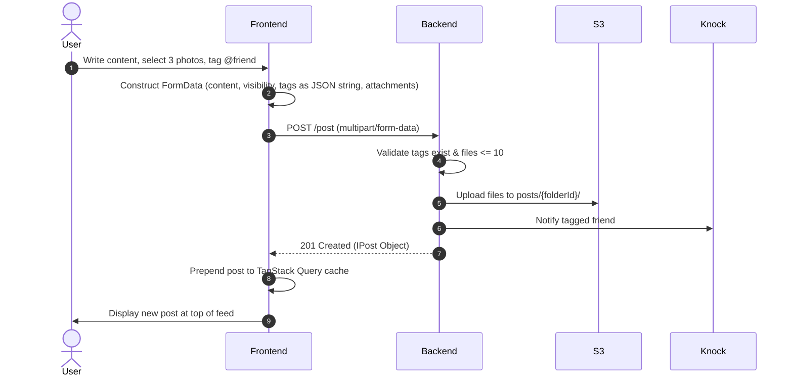

# Frontend Integration Guide: Fakebook Social Application

> **Document Version:** 1.0.0  
> **Backend Architecture Target:** Node.js (Express 5.2.1), TypeScript, MongoDB (Mongoose 9.7), Redis (6.2), AWS S3, Knock Labs, Google OAuth 2.0  
> **Target Audience:** Autonomous Frontend Engineering Agent & Senior Frontend Engineers  
> **Status:** Complete Backend Analysis & Production-Ready Integration Specification

---

## 1. Project Overview and Architecture

### 1.1 System Architecture
The **Fakebook Backend** is a monolithic REST and GraphQL service designed to support a feature-rich social networking platform. It utilizes a layered architecture separating routing, middleware, validation, services, and repositories:

- **HTTP & Transport Layer:** Express 5.2.1 with native async error handling, global JSON body parsing, CORS middleware (`cors()`), and custom validation middleware.
- **Dual API Surface:**
  - **REST API:** Primary communication layer providing standard RESTful CRUD endpoints for Auth, Users, Posts, Comments, and Notifications.
  - **GraphQL Endpoint (`/graphql`):** Secondary query/mutation layer using `graphql-http` (Express handler) with AST depth-limiting (depth 6) and bearer token context injection.
- **Database & Persistence:** MongoDB 9.7 managed via Mongoose with an abstract generic repository pattern (`DatabaseRepository<T>`), supporting soft deletes, automatic query filtering (`deletedAt`), optimistic concurrency via `__v`, field projections, and cascading cleanups.
- **In-Memory Cache & Session Store:** Redis 6.2 used for:
  - JWT token revocation blacklisting (`jti` tracking).
  - Rate-limiting and brute-force protection (login OTPs, 2FA, password resets).
  - Short-lived OTP storage (hashed with Argon2/Bcrypt) and single-use password reset verification tokens.
- **Object Storage:** Amazon Web Services (AWS) S3 bucket configured for private assets (`ObjectCannedACL.private`), handling:
  - Direct server-mediated streaming uploads/downloads.
  - S3 pre-signed upload URLs (`PutObjectCommand`) for user profile images.
  - S3 pre-signed download URLs (`GetObjectCommand`) with customizable `Content-Disposition`.
- **Third-Party Integrations:**
  - **Google OAuth 2.0:** Verified server-side via `google-auth-library`.
  - **Knock Labs (`@knocklabs/node`):** Push notifications and user workflow triggers integrating FCM (Firebase Cloud Messaging) device tokens.
  - **Nodemailer:** Email transport for 6-digit OTP delivery and HTML magic links.

---

## 2. Technology Stack and Environment Configuration

### 2.1 Backend Technology Summary
| Layer | Technology | Version | Purpose |
| :--- | :--- | :--- | :--- |
| **Runtime** | Node.js | >= 20.x | Runtime execution engine |
| **Language** | TypeScript | 5.8.2 | Strict typed backend codebase |
| **Framework** | Express | 5.2.1 | HTTP routing & middleware pipeline |
| **Database** | MongoDB / Mongoose | 9.7.1 | Primary NoSQL document database |
| **Cache & Sessions** | Redis | 6.2.0 | OTP verification, token blacklisting, rate limits |
| **Validation** | Zod | 4.4.3 | Strict runtime schema parsing & coercion |
| **Authentication** | JSONWebToken | 9.0.3 | Cryptographic Bearer token management |
| **Hashing & Encryption** | Bcrypt / Argon2 / Crypto | 6.0.0 / 0.44.0 | Password hashing, OTP hashing, AES phone encryption |
| **File Handling** | Multer | 2.2.0 | Multipart form-data handling in memory/disk |
| **Cloud Storage** | AWS SDK v3 S3 | 3.1117.0+ | Object storage for avatars, post & comment images |
| **Notifications** | Knock Labs Node SDK | 1.34.0 | User workflow execution & FCM push dispatching |
| **GraphQL** | GraphQL / graphql-http | 17.0.2 / 1.23.1 | Alternative query surface for feeds & profiles |

### 2.2 Frontend Environment Variables Required
The frontend application requires the following environment variables to communicate seamlessly with this backend:

```env
# Backend Base URLs
VITE_API_BASE_URL="http://localhost:7000"
VITE_GRAPHQL_ENDPOINT="http://localhost:7000/graphql"

# Google Authentication
# Must match the backend's GOOGLE_CLIENT_ID to obtain valid Google ID tokens
VITE_GOOGLE_CLIENT_ID="<your-google-oauth-client-id>.apps.googleusercontent.com"

# Knock Labs In-App Notification Feed (Optional for client SDK)
VITE_KNOCK_PUBLIC_API_KEY="pk_test_..."
VITE_KNOCK_FEED_CHANNEL_ID="<knock-in-app-feed-channel-id>"

# Firebase Cloud Messaging (Web Push)
VITE_FIREBASE_API_KEY="..."
VITE_FIREBASE_AUTH_DOMAIN="..."
VITE_FIREBASE_PROJECT_ID="..."
VITE_FIREBASE_STORAGE_BUCKET="..."
VITE_FIREBASE_MESSAGING_SENDER_ID="..."
VITE_FIREBASE_APP_ID="..."
VITE_FIREBASE_VAPID_KEY="..."
```

---

## 3. Backend Feature Inventory

### 3.1 Fully Implemented & Verified Capabilities
1. **Authentication & Identity:**
   - Standard user registration with Zod validation (name, email, password, phone, DOB >= 13 years, gender).
   - 6-digit OTP email confirmation with resend rate limiting and retry backoff.
   - Dual-channel password recovery: 6-digit OTP code OR 15-minute expiring magic link.
   - Dual-factor authentication (2FA): email OTP code request, verification, and toggle.
   - Two-step login: detects accounts requiring 2FA and pauses issuance of JWT tokens until OTP verification.
   - Google OAuth Sign-in & Sign-up using Google ID tokens (`idToken`).
   - Token refresh rotation with strict token-expiry concurrency protection.
   - Granular session logout (single active session vs. all active sessions).
2. **User Profiles:**
   - Profile retrieval with automatic AES-decryption of user phone numbers.
   - Public profile inspection with visit counting (admin can inspect visit counts; general users cannot).
   - Pre-signed S3 URL generation for avatar uploads.
   - Avatar removal with automated S3 object deletion.
   - Password changing with historical password verification (forbids reuse of past passwords).
   - Complete GDPR account erasure with deep cascading deletion of user posts, comments, reactions, and S3 folders.
3. **Posts Management:**
   - Multi-attachment image uploading (up to 10 images, max 2MB each, JPEG/PNG/WebP).
   - Granular post visibility (`public`, `friends`, `only_me`).
   - User tagging with auto-mention resolution, existence validation, and push notifications.
   - Geolocation tagging (name, latitude, longitude).
   - Post sharing with flattened tree references (sharing a share links to the original root post).
   - Post editing with attachment delta management (`removeAttachments` + new uploads).
   - Facebook-style multi-reactions (`like`, `love`, `care`, `haha`, `wow`, `sad`, `angry`) with toggle off and reaction swapping.
   - Real-time reaction breakdown counters (`reactionsCount`, `reactionsBreakdown`).
   - Soft-delete and restore lifecycles (author or admin).
   - Hard deletion with full cascading teardown of comments and S3 assets.
4. **Comments & Replies:**
   - Top-level comments on visible posts.
   - Image attachments on comments (strict maximum of 2 images).
   - Infinite nested or single-tier threaded replies (`/:commentId/reply`).
   - Comment reactions with toggle and breakdown counters.
   - Comment editing with delta attachment removal.
   - Recursive cascade deletion (author, post owner, or admin) deleting child reply trees.
5. **Asset Serving & S3 Streaming:**
   - Server-streamed asset downloads at `GET /uploads/*path` with `Cross-Origin-Resource-Policy` headers.
   - Pre-signed S3 download URLs at `GET /pre-signed/*path`.
6. **Notifications:**
   - FCM token registration associated with Knock user identities.
   - Admin trigger for test and welcome messages.
7. **GraphQL Engine:**
   - Feeds, single post queries, user profile, and post reactions.

### 3.2 Inactive / Missing / Unsupported Functionality
- **Chat / Direct Messaging:** The entire module (`/message`) is **commented out** in `app.bootstrap.ts` and `src/modules/message/message.controller.ts`. The frontend **cannot** implement real-time 1-on-1 or group chat until the backend implements and activates this module.
- **Friend Request Flow:** The `IUser` model contains a `friends` array (`Types.ObjectId[]`), and visibility logic checks `user.friends`. However, **there are no REST or GraphQL endpoints** to send, accept, decline, or list friend requests! Friends currently only exist as a database schema relation.
- **User Search / Directory:** There is no dedicated endpoint to search or browse users (only posts and comments have a `search` query parameter). Tagging users requires knowing their `ObjectId` beforehand.
- **Notification Inbox:** Knock triggers push notifications to FCM, but there is no database-backed notification inbox endpoint (e.g. `GET /notifications`). In-app notification feeds must either use Knock's client-side SDK or await a backend notification repository.

---

## 4. API Conventions and Base URL

### 4.1 Base URLs and Protocols
- **REST Base URL:** `http://localhost:7000` (or `PORT` defined in `.env`)
- **GraphQL Endpoint:** `http://localhost:7000/graphql`
- **Asset Streaming URL:** `http://localhost:7000/uploads/{s3_key}`
- **Pre-signed URL Generator:** `http://localhost:7000/pre-signed/{s3_key}`

### 4.2 Standard Success Response Envelope
All REST API endpoints (with the exception of raw file streaming and GraphQL) return an envelope formatted via `successResponse`:

```json
{
  "message": "success",
  "status": 200,
  "data": { ... }
}
```

- `message`: Descriptive status string (e.g., `"success"`, `"Email confirmed successfully"`, `"logged in successfully"`).
- `status`: HTTP status code repeated in the payload (`200`, `201`, etc.).
- `data`: Typed payload object. For deletion operations or simple acknowledgments, `data` may be omitted or empty.

### 4.3 Standard Error Response Envelope
Handled centrally by `globalErrorHandler` in `src/middleware/error.middleware.ts`:

#### Operational Error (Validation, Not Found, Conflict, Unauthorized):
```json
{
  "status": 400,
  "message": "Validation error",
  "cause": {
    "error": [
      {
        "key": "body",
        "issues": [
          {
            "message": "First name must be at least 2 characters",
            "path": ["firstName"]
          }
        ]
      }
    ]
  }
}
```
*(In development mode `NODE_ENV=development`, an additional `stack` property is present).*

#### Duplicate Key Error (MongoDB 11000):
```json
{
  "status": 409,
  "message": "Duplicate value for field: email"
}
```

#### Unhandled 500 Error:
```json
{
  "status": 500,
  "message": "internal server error"
}
```

### 4.4 Pagination Envelope
Returned by `getPosts`, `getComments`, and `getReplies`:
```json
{
  "message": "success",
  "status": 200,
  "data": {
    "posts": {
      "data": [ ... ],
      "total": 42,
      "page": 1,
      "limit": 10,
      "totalPages": 5,
      "hasNextPage": true,
      "hasPrevPage": false
    }
  }
}
```
*Note:* If `page` query parameter is omitted, the backend returns all documents in `data`, with `total` populated, while `page`, `limit`, `totalPages`, `hasNextPage`, and `hasPrevPage` are `undefined`.

---

## 5. Authentication and Authorization

### 5.1 Token Strategy and Storage
The application implements dual JWT tokens:
1. **Access Token:**
   - Default validity: 1800 seconds (30 minutes).
   - Audience: `[1, "user"]` (or `[1, "admin"]`).
   - Signed with `ACCESS_TOKEN_SECRET_KEY` (or `SYSTEM_ACCESS_TOKEN_SECRET_KEY` for Admins).
   - Shared `jti` (UUID) with its paired refresh token.
2. **Refresh Token:**
   - Default validity: 31,536,000 seconds (1 year).
   - Audience: `[2, "user"]` (or `[2, "admin"]`).
   - Signed with `REFRESH_TOKEN_SECRET_KEY` (or `SYSTEM_REFRESH_TOKEN_SECRET_KEY` for Admins).
   - Shared `jti` (UUID) with its paired access token.

### 5.2 Header Conventions
All protected endpoints require the HTTP Authorization header:
```http
Authorization: Bearer <token>
```
- For standard endpoints: `<token>` must be an **Access Token** (`TokenTypeEnum.access = 1`).
- For `POST /user/rotate-token`: `<token>` must be a **Refresh Token** (`TokenTypeEnum.refresh = 2`).

### 5.3 Critical Token Rotation Concurrency Rule
In `UserService.rotateToken`, the backend enforces this strict condition:
```typescript
if ((iat + ACCESS_TOKEN_EXPIRES_IN) * 1000 > Date.now() + 30000) {
  throw new ConflictException("Current Access token still valid");
}
```
> **IMPORTANT INTEGRATION RULE FOR FRONTEND:**  
> The backend **rejects** token rotation with a **`409 Conflict`** if the client attempts to refresh while the current access token still has more than 30 seconds of remaining validity!  
> **Frontend Action:** Do not execute preemptive token refresh on app launch if the current token is fresh. Only refresh when:
> 1. An API call receives a `401 Unauthorized` ("Token expired").
> 2. Or the client timer calculates `< 30 seconds` before token expiration.

### 5.4 Token Revocation & Invalidation
The backend maintains active blacklists in Redis:
- **Single Logout:** `Redis.revokeTokenKey({ userId, jti })` stores the token's `jti` with TTL equal to the remaining refresh token life. Any request with this `jti` is immediately rejected with `401 Unauthorized` ("Invalid login session please try to login again").
- **Global Logout & Password Reset:** Sets `user.changeCredentialsTime = new Date()`. In `TokenService.decodeToken`, any token whose issued-at time (`iat`) is earlier than `changeCredentialsTime` is immediately rejected with `401 Unauthorized`.

### 5.5 Two-Factor Authentication (2FA) Lifecycle
1. User logs in via `POST /auth/login`.
2. If `user.twoFactorVerified === true`, the API does **not** return tokens. Instead, it triggers an email OTP code (valid for 120 seconds) and returns:
   ```json
   {
     "message": "success",
     "status": 200,
     "data": {
       "twoFactorRequired": true
     }
   }
   ```
3. Frontend must transition to a 2FA Verification Screen.
4. User enters the 6-digit OTP code received by email.
5. Frontend calls `POST /auth/login-confirm` with `{ email, otp }`.
6. Backend verifies the OTP and returns the final `{ access_token, refresh_token }`.

---

## 6. Complete Endpoint Reference

### 6.1 Authentication Module (`/auth`)

---

#### 6.1.1 Login
- **Method & Path:** `POST /auth/login`
- **Auth:** Public
- **Request Body:**
  ```json
  {
    "email": "user@example.com",
    "password": "SecurePassword123!",
    "fcmToken": "optional-fcm-device-token-string"
  }
  ```
- **Validation Rules:**
  - `email`: Valid email format.
  - `password`: String, min 8, max 30, must contain 1 uppercase, 1 lowercase, 1 number, 1 special character (`/^(?=.*[a-z])(?=.*[A-Z])(?=.*\d)(?=.*[^A-Za-z0-9]).{8,30}$/`).
  - `fcmToken`: Optional string.
- **Success Response (Standard Login - 200 OK):**
  ```json
  {
    "message": "success",
    "status": 200,
    "data": {
      "access_token": "eyJhbGciOiJIUzI1NiIsInR5cCI6IkpXVCJ9...",
      "refresh_token": "eyJhbGciOiJIUzI1NiIsInR5cCI6IkpXVCJ9..."
    }
  }
  ```
- **Success Response (2FA Required - 200 OK):**
  ```json
  {
    "message": "success",
    "status": 200,
    "data": {
      "twoFactorRequired": true
    }
  }
  ```
- **Error Responses:**
  - `401 Unauthorized`: `"Email or Password is incorrect"` (also returned if email is not confirmed or user provider is not 'system').
  - `400 Bad Request`: Validation failure.
- **Side Effects:** If `fcmToken` is provided and 2FA is not required, registers FCM token with Knock.

---

#### 6.1.2 Signup
- **Method & Path:** `POST /auth/signup`
- **Auth:** Public
- **Request Body:**
  ```json
  {
    "firstName": "John",
    "lastName": "Doe",
    "email": "john.doe@example.com",
    "password": "Password123!",
    "confirmPassword": "Password123!",
    "phone": "01012345678",
    "dateOfBirth": "1998-05-15",
    "gender": "male"
  }
  ```
- **Validation Rules:**
  - `firstName`, `lastName`: Trimmed, 2-50 characters, one word only (`/^[\p{L}'-]+$/u`).
  - `phone`: Egyptian mobile format (`/^(?:\+20|0)?1[0125]\d{8}$/`).
  - `dateOfBirth`: Coerced to Date, must be <= today, >= 1900-01-01, and user must be at least 13 years old.
  - `gender`: `"male"` or `"female"`.
  - `confirmPassword`: Must match `password`.
- **Success Response (201 Created):**
  ```json
  {
    "message": "success",
    "status": 201,
    "data": {
      "_id": "670f1a9e8b9123456789abcd",
      "firstName": "John",
      "lastName": "Doe",
      "email": "john.doe@example.com",
      "phone": "3a4f...encrypted...9b",
      "dateOfBirth": "1998-05-15T00:00:00.000Z",
      "gender": "male",
      "provider": "system",
      "role": "user",
      "twoFactorVerified": false,
      "profileCoverPictures": [],
      "profileVisits": 0,
      "createdAt": "2026-10-19T12:00:00.000Z",
      "updatedAt": "2026-10-19T12:00:00.000Z",
      "fullName": "John Doe",
      "id": "670f1a9e8b9123456789abcd"
    }
  }
  ```
- **Error Responses:**
  - `409 Conflict`: `"Email already exist"`.
  - `429 Too Many Requests`: `"Too many attempts. Try again in X minutes."` (OTP rate limiter).
- **Side Effects:** Hashes password with Bcrypt, encrypts phone with AES-256-CBC, generates 6-digit OTP, stores in Redis for 300s, emits background email.

---

#### 6.1.3 Confirm Email
- **Method & Path:** `PATCH /auth/confirm-email`
- **Auth:** Public
- **Request Body:**
  ```json
  {
    "email": "john.doe@example.com",
    "otp": "482910"
  }
  ```
- **Validation Rules:**
  - `email`: Valid email.
  - `otp`: Exactly 6 numeric digits (`/^\d+$/`).
- **Success Response (200 OK):**
  ```json
  {
    "message": "Email confirmed successfully",
    "status": 200
  }
  ```
- **Error Responses:**
  - `404 Not Found`: `"cannot find account with this email"`.
  - `400 Bad Request`: `"OTP has expired or is invalid"`, `"Invalid OTP"`.
  - `429 Too Many Requests`: `"Maximum invalid attempts exceeded. Please request a new code."` (exceeded 5 wrong tries).

---

#### 6.1.4 Resend Confirm Email OTP
- **Method & Path:** `PATCH /auth/resend-confirm-email`
- **Auth:** Public
- **Request Body:**
  ```json
  {
    "email": "john.doe@example.com"
  }
  ```
- **Success Response (200 OK):**
  ```json
  {
    "message": "We have sent you another otp",
    "status": 200
  }
  ```
- **Error Responses:**
  - `409 Conflict`: `"Please wait X seconds before requesting a new otp."` (if active OTP is still in Redis).
  - `404 Not Found`: `"cannot find account with this email"`.
  - `429 Too Many Requests`: Triggered if user hits the generation attempt limit (max 3 per hour).

---

#### 6.1.5 Forgot Password
- **Method & Path:** `POST /auth/forgot-password`
- **Auth:** Public
- **Request Body:**
  ```json
  {
    "email": "john.doe@example.com",
    "method": "otp"
  }
  ```
  *(or `"method": "link"`)*
- **Validation Rules:**
  - `method`: Optional enum `["otp", "link"]`, defaults to `"otp"`.
- **Success Response (200 OK):**
  ```json
  {
    "message": "If this email exists, a reset link or code has been sent",
    "status": 200
  }
  ```
- **Side Effects:**
  - If `"otp"`: sends 6-digit OTP to user email.
  - If `"link"`: sends email with link `${CLIENT_URL}/reset-password?token=${jwtToken}` (JWT valid for 15 min).

---

#### 6.1.6 Verify Forgot Password OTP
- **Method & Path:** `POST /auth/verify-otp`
- **Auth:** Public
- **Request Body:**
  ```json
  {
    "email": "john.doe@example.com",
    "otp": "837192"
  }
  ```
- **Success Response (200 OK):**
  ```json
  {
    "message": "OTP verified successfully",
    "status": 200,
    "data": {
      "resetToken": "a3b98c54-1234-4567-89ab-cdef01234567"
    }
  }
  ```
- **Error Responses:**
  - `400 Bad Request`: `"OTP has expired or is invalid"` or `"Invalid OTP"`.
  - `429 Too Many Requests`: Maximum verify attempts exceeded.

---

#### 6.1.7 Verify Magic Link
- **Method & Path:** `GET /auth/verify-link?token=<jwt-token>`
- **Auth:** Public
- **Query Parameters:** `token` (string, required).
- **Success Response (200 OK):**
  ```json
  {
    "message": "Email verified successfully",
    "status": 200,
    "data": {
      "resetToken": "b4c09d65-2345-5678-90bc-def012345678"
    }
  }
  ```
- **Error Responses:**
  - `400 Bad Request`: `"Invalid or missing token"`, `"Magic link is invalid or expired"`, `"Magic link has already been used"`.

---

#### 6.1.8 Reset Password
- **Method & Path:** `PATCH /auth/reset-password`
- **Auth:** Public
- **Request Body:**
  ```json
  {
    "resetToken": "a3b98c54-1234-4567-89ab-cdef01234567",
    "password": "NewStrongPassword1!",
    "confirmPassword": "NewStrongPassword1!"
  }
  ```
- **Validation Rules:**
  - `resetToken`: String, min 1.
  - `password`: Regex validated (same as signup).
  - `confirmPassword`: Must match `password`.
- **Success Response (200 OK):**
  ```json
  {
    "message": "Password reset successfully",
    "status": 200,
    "data": {
      "user": {
        "_id": "670f1a9e8b9123456789abcd",
        "firstName": "John",
        "lastName": "Doe",
        "email": "john.doe@example.com"
      }
    }
  }
  ```
- **Error Responses:**
  - `400 Bad Request`: `"Reset token is invalid or expired"`.
- **Side Effects:** Invalidates `resetToken`, sets `changeCredentialsTime = new Date()`, purges all existing JWT sessions in Redis.

---

#### 6.1.9 Sign In / Sign Up with Google
- **Method & Path:** `POST /auth/signup/gmail`
- **Auth:** Public
- **Request Body:**
  ```json
  {
    "idToken": "eyJhbGciOiJSUzI1NiIsImtpZCI6..."
  }
  ```
- **Success Response (Existing Account - 200 OK):**
  ```json
  {
    "message": "logged in successfully",
    "status": 200,
    "data": {
      "access_token": "eyJhbGciOiJIUzI1NiIsIn...",
      "refresh_token": "eyJhbGciOiJIUzI1NiIsIn..."
    }
  }
  ```
- **Success Response (New Account - 201 Created):**
  ```json
  {
    "message": "signed up successfully",
    "status": 201,
    "data": {
      "access_token": "eyJhbGciOiJIUzI1NiIsIn...",
      "refresh_token": "eyJhbGciOiJIUzI1NiIsIn..."
    }
  }
  ```
- **Error Responses:**
  - `409 Conflict`: `"invalid provider"` (if account already exists under `"system"` email/password provider).
  - `400 Bad Request`: `"fail to verify by google"`.

---

#### 6.1.10 Login Confirm (2FA Step 2)
- **Method & Path:** `POST /auth/login-confirm`
- **Auth:** Public
- **Request Body:**
  ```json
  {
    "email": "john.doe@example.com",
    "otp": "654321"
  }
  ```
- **Success Response (200 OK):**
  ```json
  {
    "message": "logged in successfully",
    "status": 200,
    "data": {
      "access_token": "eyJhbGciOiJIUzI1NiIsIn...",
      "refresh_token": "eyJhbGciOiJIUzI1NiIsIn..."
    }
  }
  ```
- **Error Responses:**
  - `400 Bad Request`: `"2FA is not enabled for this account"`, `"OTP has expired or is invalid"`, `"2FA code is incorrect"`.
  - `429 Too Many Requests`: Maximum verify attempts exceeded.

---

#### 6.1.11 Request 2FA Code
- **Method & Path:** `PATCH /auth/request-2fa`
- **Auth:** Protected (`Bearer <AccessToken>`)
- **Request Body:** None
- **Success Response (200 OK):**
  ```json
  {
    "message": "2fa code sent successfully",
    "status": 200
  }
  ```
- **Side Effects:** Generates OTP in Redis (TTL: 120 seconds), sends email.

---

#### 6.1.12 Enable 2FA
- **Method & Path:** `PATCH /auth/enable-2fa`
- **Auth:** Protected (`Bearer <AccessToken>`)
- **Request Body:**
  ```json
  {
    "otp": "123456"
  }
  ```
- **Success Response (200 OK):**
  ```json
  {
    "message": "2fa enabled successfully",
    "status": 200
  }
  ```
- **Side Effects:** Verifies code, updates user document `twoFactorVerified = true`.

---

### 6.2 User Module (`/user`)

---

#### 6.2.1 Get Current User Profile
- **Method & Path:** `GET /user`
- **Auth:** Protected (`Bearer <AccessToken>`, Role: `user` or `admin`)
- **Success Response (200 OK):**
  ```json
  {
    "message": "success",
    "status": 200,
    "data": {
      "profile": {
        "_id": "670f1a9e8b9123456789abcd",
        "firstName": "John",
        "lastName": "Doe",
        "email": "john.doe@example.com",
        "phone": "01012345678",
        "dateOfBirth": "1998-05-15T00:00:00.000Z",
        "gender": "male",
        "provider": "system",
        "role": "user",
        "twoFactorVerified": false,
        "profilePicture": "fakebook/users/670f1a9e8b9123456789abcd/profile/1a2b3c__avatar.png",
        "profileCoverPictures": [],
        "profileVisits": 12,
        "friends": [],
        "createdAt": "2026-10-19T12:00:00.000Z",
        "updatedAt": "2026-10-19T12:00:00.000Z",
        "fullName": "John Doe",
        "id": "670f1a9e8b9123456789abcd"
      }
    }
  }
  ```
- **Note:** The `phone` property is automatically decrypted before response serialization.

---

#### 6.2.2 Logout
- **Method & Path:** `POST /user/logout`
- **Auth:** Protected (`Bearer <AccessToken>`)
- **Request Body (Optional):**
  ```json
  {
    "flag": "current"
  }
  ```
  *(or `"flag": "all"`. Defaults to `"current"` if empty body).*
- **Success Response (201 Created for 'current', 200 OK for 'all'):**
  ```json
  {
    "message": "success",
    "status": 201
  }
  ```
- **Side Effects:**
  - `"current"`: Blacklists token `jti` in Redis for the remainder of its TTL.
  - `"all"`: Updates `changeCredentialsTime` to current timestamp, invalidating all issued tokens.

---

#### 6.2.3 Rotate Tokens
- **Method & Path:** `POST /user/rotate-token`
- **Auth:** Protected (`Bearer <RefreshToken>`) — **Must provide the Refresh Token!**
- **Success Response (201 Created):**
  ```json
  {
    "message": "success",
    "status": 201,
    "data": {
      "access_token": "eyJhbGciOiJIUzI1NiIsIn...",
      "refresh_token": "eyJhbGciOiJIUzI1NiIsIn..."
    }
  }
  ```
- **Error Responses:**
  - `409 Conflict`: `"Current Access token still valid"` (Thrown if access token has more than 30 seconds of life remaining).
  - `401 Unauthorized`: `"Invalid login session please try to login again"`.

---

#### 6.2.4 Inspect Public User Profile
- **Method & Path:** `GET /user/:userId/share-profile`
- **Auth:** Optional (`Bearer <AccessToken>` if logged in; public if guest)
- **Path Parameters:** `userId` (24-hex ObjectId).
- **Success Response (200 OK):**
  ```json
  {
    "message": "success",
    "status": 200,
    "data": {
      "account": {
        "_id": "670f1a9e8b9123456789abcd",
        "firstName": "John",
        "lastName": "Doe",
        "profilePicture": "fakebook/users/670f1a9e8b9123456789abcd/profile/1a2b3c__avatar.png"
      }
    }
  }
  ```
- **Side Effects:** Increments `profileVisits` by +1 in MongoDB.
- **Permissions:** If the requester is an **Admin**, `account.profileVisits` is included; for standard users or guests, `profileVisits` is stripped (`undefined`).

---

#### 6.2.5 Request Pre-Signed Profile Image Upload URL
- **Method & Path:** `PATCH /user/profile-image`
- **Auth:** Protected (`Bearer <AccessToken>`)
- **Request Body:**
  ```json
  {
    "contentType": "image/png",
    "originalname": "avatar.png"
  }
  ```
- **Success Response (200 OK):**
  ```json
  {
    "message": "success",
    "status": 200,
    "data": {
      "user": { ... },
      "url": "https://fakebook-bucket.s3.eu-west-1.amazonaws.com/fakebook/users/670f1a9e8b9123456789abcd/profile/uuid__avatar.png?X-Amz-Algorithm=..."
    }
  }
  ```
- **Upload Workflow:**
  1. Frontend calls `PATCH /user/profile-image` to obtain `{ url }`.
  2. Frontend sends direct HTTP `PUT` to `url` with image binary and matching `Content-Type`.
  3. *(Note: Backend comments indicate DB profilePicture update is handled via AWS Lambda S3 trigger, or frontend sends avatar key in future profile update).*

---

#### 6.2.6 Remove Profile Image
- **Method & Path:** `DELETE /user/remove-profile-image`
- **Auth:** Protected (`Bearer <AccessToken>`)
- **Success Response (200 OK):**
  ```json
  {
    "message": "Profile image removed successfully",
    "status": 200
  }
  ```
- **Error Responses:**
  - `404 Not Found`: `"There is no profile picture to remove"`.

---

#### 6.2.7 Change Password
- **Method & Path:** `PATCH /user/change-password`
- **Auth:** Protected (`Bearer <AccessToken>`)
- **Request Body:**
  ```json
  {
    "oldPassword": "CurrentPassword123!",
    "newPassword": "BrandNewPassword123!",
    "confirmNewPassword": "BrandNewPassword123!"
  }
  ```
- **Validation Rules:**
  - `newPassword`: Must differ from `oldPassword`.
  - `confirmNewPassword`: Must match `newPassword`.
- **Success Response (200 OK):**
  ```json
  {
    "message": "success",
    "status": 200,
    "data": {
      "access_token": "eyJhbGciOiJIUzI1NiIsIn...",
      "refresh_token": "eyJhbGciOiJIUzI1NiIsIn..."
    }
  }
  ```
- **Error Responses:**
  - `400 Bad Request`: `"Old password is incorrect"`, `"New password cannot be the same as any of the previous passwords"` (checks historical `oldPasswords`).
- **Side Effects:** Stores old password in `oldPasswords` array, updates `changeCredentialsTime`, purges Redis token cache, returns fresh tokens.

---

#### 6.2.8 Delete Account
- **Method & Path:** `DELETE /user/delete-account`
- **Auth:** Protected (`Bearer <AccessToken>`)
- **Success Response (200 OK):**
  ```json
  {
    "message": "account deleted successfully",
    "status": 200
  }
  ```
- **Side Effects (Deep Cascade):**
  1. Deletes all user's posts, their comments, and S3 folders.
  2. Deletes user's comments on other posts, cascading counters.
  3. Decrements reactions created by this user across all posts and comments.
  4. Deletes user document from MongoDB.
  5. Deletes S3 folder `users/${userId}`.

---

### 6.3 Post Module (`/post`)

---

#### 6.3.1 Create Post
- **Method & Path:** `POST /post`
- **Auth:** Protected (`Bearer <AccessToken>`)
- **Content-Type:** `multipart/form-data`
- **Form Fields:**
  - `content`: Optional string (max 63,206 chars). *Either `content` or at least 1 `attachments` file is required.*
  - `visibility`: Required string: `"public"`, `"friends"`, or `"only_me"`.
  - `tags`: Optional JSON string array of 24-hex ObjectIds: `'["670f1a9e8b9123456789abcd"]'`.
  - `location`: Optional JSON string: `'{"name":"Cairo, Egypt","lat":30.0444,"lng":31.2357}'`.
  - `attachments`: File input (up to 10 files, image format: jpeg, png, jpg, webp, max 2MB each).
- **Success Response (201 Created):**
  ```json
  {
    "message": "success",
    "status": 201,
    "data": {
      "post": {
        "_id": "6713bb99a5e4d2001e52bcde",
        "createdBy": "670f1a9e8b9123456789abcd",
        "content": "Hello World from my new app!",
        "visibility": "public",
        "tags": ["670f1a9e8b9123456789abcd"],
        "location": {
          "name": "Cairo, Egypt",
          "lat": 30.0444,
          "lng": 31.2357
        },
        "attachments": [
          "fakebook/posts/c5a1...uuid/uuid__image.png"
        ],
        "reactions": [],
        "reactionsCount": 0,
        "reactionsBreakdown": {},
        "commentsCount": 0,
        "shareCount": 0,
        "isEdited": false,
        "createdAt": "2026-10-19T13:00:00.000Z",
        "updatedAt": "2026-10-19T13:00:00.000Z"
      }
    }
  }
  ```
- **Error Responses:**
  - `400 Bad Request`: Validation failure (missing content and attachment, tag IDs duplicate, > 10 files).
  - `404 Not Found`: `"One or more tagged users not found"`.

---

#### 6.3.2 List Feed Posts
- **Method & Path:** `GET /post`
- **Auth:** Protected (`Bearer <AccessToken>`)
- **Query Parameters:**
  - `page`: Optional number (defaults to 1 if provided).
  - `limit`: Optional number (defaults to 10 if page provided).
  - `search`: Optional string (regex search on post content).
- **Success Response (200 OK):**
  ```json
  {
    "message": "success",
    "status": 200,
    "data": {
      "posts": {
        "data": [
          {
            "_id": "6713bb99a5e4d2001e52bcde",
            "content": "Hello World!",
            "visibility": "public",
            "attachments": [
              "fakebook/posts/c5a1...uuid/uuid__image.png"
            ],
            "createdBy": {
              "_id": "670f1a9e8b9123456789abcd",
              "firstName": "John",
              "lastName": "Doe",
              "profilePicture": "fakebook/users/.../avatar.png"
            },
            "tags": [],
            "reactionsCount": 5,
            "reactionsBreakdown": {
              "like": 4,
              "love": 1
            },
            "commentsCount": 2,
            "shareCount": 0,
            "isEdited": false,
            "createdAt": "2026-10-19T13:00:00.000Z",
            "updatedAt": "2026-10-19T13:00:00.000Z"
          }
        ],
        "total": 1,
        "page": 1,
        "limit": 10,
        "totalPages": 1,
        "hasNextPage": false,
        "hasPrevPage": false
      }
    }
  }
  ```
- **Visibility Filtering:** Automatically applies:
  - `visibility: public`
  - OR `visibility: only_me` (created by requester)
  - OR `visibility: friends` (requester is author OR in author's friends list)
  - OR user is tagged in `tags`.

---

#### 6.3.3 Get Single Post
- **Method & Path:** `GET /post/:postId`
- **Auth:** Protected (`Bearer <AccessToken>`)
- **Path Parameters:** `postId` (24-hex ObjectId).
- **Success Response (200 OK):**
  ```json
  {
    "message": "success",
    "status": 200,
    "data": {
      "post": {
        "_id": "6713bb99a5e4d2001e52bcde",
        "content": "Hello World!",
        "visibility": "public",
        "createdBy": {
          "_id": "670f1a9e8b9123456789abcd",
          "firstName": "John",
          "lastName": "Doe",
          "profilePicture": "..."
        },
        "tags": [],
        "reactions": [
          {
            "createdBy": "670f1a9e8b9123456789abcd",
            "reactionType": "like",
            "createdAt": "2026-10-19T13:05:00.000Z"
          }
        ],
        "reactionsCount": 1,
        "reactionsBreakdown": { "like": 1 },
        "commentsCount": 0,
        "shareCount": 0,
        "isEdited": false,
        "createdAt": "2026-10-19T13:00:00.000Z",
        "updatedAt": "2026-10-19T13:00:00.000Z"
      }
    }
  }
  ```
- **Error Responses:**
  - `404 Not Found`: Post not found or not visible to user.

---

#### 6.3.4 Share Post
- **Method & Path:** `POST /post/:postId/share`
- **Auth:** Protected (`Bearer <AccessToken>`)
- **Path Parameters:** `postId` (Target post to share).
- **Request Body (JSON or Form):**
  ```json
  {
    "content": "Check out this great post!",
    "visibility": "public",
    "tags": ["670f1a9e8b9123456789abcd"]
  }
  ```
- **Validation Rules:**
  - Target post **must** have `visibility === "public"`.
- **Success Response (201 Created):**
  ```json
  {
    "message": "success",
    "status": 201,
    "data": {
      "post": {
        "_id": "6713cd10a5e4d2001e52bcef",
        "createdBy": "670f1a9e8b9123456789abcd",
        "content": "Check out this great post!",
        "visibility": "public",
        "sharedFrom": {
          "originalPostId": "6713bb99a5e4d2001e52bcde",
          "originalAuthorId": "670f1a9e8b9123456789abcd"
        },
        "reactionsCount": 0,
        "commentsCount": 0,
        "shareCount": 0,
        "createdAt": "2026-10-19T13:10:00.000Z"
      }
    }
  }
  ```
- **Error Responses:**
  - `403 Forbidden`: `"You are not allowed to share this post"` (if visibility is not public).
  - `404 Not Found`: Target post does not exist.
- **Side Effects:** Increments `shareCount` on the original root post.

---

#### 6.3.5 Update Post
- **Method & Path:** `PATCH /post/:postId`
- **Auth:** Protected (`Bearer <AccessToken>`)
- **Content-Type:** `multipart/form-data`
- **Form Fields:**
  - `content`: Optional string.
  - `visibility`: Optional `"public" | "friends" | "only_me"`.
  - `tags`: Optional JSON string array of ObjectIds.
  - `location`: Optional JSON string.
  - `removeAttachments`: Optional JSON string array of S3 keys to delete: `'["fakebook/posts/.../image.png"]'`.
  - `attachments`: New file uploads (Multer).
- **Success Response (200 OK):**
  ```json
  {
    "message": "success",
    "status": 200,
    "data": {
      "post": {
        "_id": "6713bb99a5e4d2001e52bcde",
        "content": "Updated content",
        "isEdited": true,
        "updatedAt": "2026-10-19T13:15:00.000Z"
      }
    }
  }
  ```
- **Error Responses:**
  - `403 Forbidden`: `"You are not allowed to update this post"`.
  - `400 Bad Request`: At least one field required; total attachments > 10; post empty.
- **Side Effects:** Deletes `removeAttachments` from S3. Notifies newly tagged users.

---

#### 6.3.6 React to Post
- **Method & Path:** `POST /post/:postId/react`
- **Auth:** Protected (`Bearer <AccessToken>`)
- **Request Body:**
  ```json
  {
    "reaction": "love"
  }
  ```
- **Validation Rules:**
  - `reaction`: Enum `["like", "love", "care", "haha", "wow", "sad", "angry"]`.
- **Toggle & Swap Behavior:**
  - Reacting with the **same** reaction type removes the reaction (toggles off).
  - Reacting with a **different** reaction type updates the reaction (swaps reaction).
  - Reacting when no prior reaction exists adds it.
- **Success Response (200 OK):**
  ```json
  {
    "message": "success",
    "status": 200,
    "data": {
      "post": {
        "_id": "6713bb99a5e4d2001e52bcde",
        "reactionsCount": 1,
        "reactionsBreakdown": {
          "love": 1
        }
      }
    }
  }
  ```

---

#### 6.3.7 Soft-Delete Post
- **Method & Path:** `DELETE /post/:postId/soft-delete`
- **Auth:** Protected (`Bearer <AccessToken>`)
- **Permissions:** Author or Admin.
- **Success Response (200 OK):**
  ```json
  {
    "message": "success",
    "status": 200,
    "data": {
      "post": {
        "_id": "6713bb99a5e4d2001e52bcde",
        "deletedAt": "2026-10-19T13:20:00.000Z"
      }
    }
  }
  ```

---

#### 6.3.8 Restore Soft-Deleted Post
- **Method & Path:** `PATCH /post/:postId/restore`
- **Auth:** Protected (`Bearer <AccessToken>`)
- **Permissions:** Author or Admin.
- **Success Response (200 OK):**
  ```json
  {
    "message": "success",
    "status": 200,
    "data": {
      "post": {
        "_id": "6713bb99a5e4d2001e52bcde",
        "restoredAt": "2026-10-19T13:22:00.000Z"
      }
    }
  }
  ```

---

#### 6.3.9 Hard-Delete Post
- **Method & Path:** `DELETE /post/:postId`
- **Auth:** Protected (`Bearer <AccessToken>`)
- **Permissions:** Author or Admin.
- **Success Response (200 OK):**
  ```json
  {
    "message": "success",
    "status": 200,
    "data": {
      "post": {
        "_id": "6713bb99a5e4d2001e52bcde"
      }
    }
  }
  ```
- **Side Effects:** Cascades deletion to all comments, replies, S3 post assets, and S3 comment assets.

---

### 6.4 Comment Module (`/post/:postId/comment`)

---

#### 6.4.1 Create Comment
- **Method & Path:** `POST /post/:postId/comment`
- **Auth:** Protected (`Bearer <AccessToken>`)
- **Content-Type:** `multipart/form-data`
- **Form Fields:**
  - `content`: Optional string (max 8,000 chars).
  - `tags`: Optional JSON string array of ObjectIds.
  - `attachments`: File input (**Max 2 image files**, max 2MB each).
- **Validation Rules:**
  - Post must exist and be visible to user.
  - Must provide either `content` or at least 1 file.
  - Maximum 2 attachments permitted.
- **Success Response (201 Created):**
  ```json
  {
    "message": "success",
    "status": 201,
    "data": {
      "comment": {
        "_id": "6713d2f0a5e4d2001e52bd01",
        "postId": "6713bb99a5e4d2001e52bcde",
        "createdBy": "670f1a9e8b9123456789abcd",
        "content": "This is a great comment!",
        "attachments": [],
        "tags": [],
        "reactions": [],
        "reactionsCount": 0,
        "reactionsBreakdown": {},
        "repliesCount": 0,
        "isEdited": false,
        "createdAt": "2026-10-19T13:30:00.000Z",
        "updatedAt": "2026-10-19T13:30:00.000Z"
      }
    }
  }
  ```
- **Side Effects:** Increments `post.commentsCount`. Uploads files to S3 path `posts/${post.folderId}/comments`. Notifies post owner.

---

#### 6.4.2 List Top-Level Comments
- **Method & Path:** `GET /post/:postId/comment`
- **Auth:** Protected (`Bearer <AccessToken>`)
- **Query Parameters:** `page`, `limit`, `search`.
- **Success Response (200 OK):**
  ```json
  {
    "message": "success",
    "status": 200,
    "data": {
      "comments": {
        "data": [
          {
            "_id": "6713d2f0a5e4d2001e52bd01",
            "postId": "6713bb99a5e4d2001e52bcde",
            "content": "This is a great comment!",
            "attachments": [],
            "createdBy": {
              "_id": "670f1a9e8b9123456789abcd",
              "firstName": "John",
              "lastName": "Doe",
              "profilePicture": "..."
            },
            "reactionsCount": 0,
            "reactionsBreakdown": {},
            "repliesCount": 1,
            "isEdited": false,
            "createdAt": "2026-10-19T13:30:00.000Z",
            "updatedAt": "2026-10-19T13:30:00.000Z"
          }
        ],
        "total": 1,
        "page": 1,
        "limit": 10,
        "totalPages": 1,
        "hasNextPage": false,
        "hasPrevPage": false
      }
    }
  }
  ```
- **Sort:** Descending (`createdAt: -1`, newest first). Excludes child replies (`commentId: { $exists: false }`).

---

#### 6.4.3 Get Single Comment
- **Method & Path:** `GET /post/:postId/comment/:commentId`
- **Auth:** Protected (`Bearer <AccessToken>`)
- **Success Response (200 OK):**
  ```json
  {
    "message": "success",
    "status": 200,
    "data": {
      "comment": {
        "_id": "6713d2f0a5e4d2001e52bd01",
        "content": "This is a great comment!",
        "createdBy": { ... }
      }
    }
  }
  ```

---

#### 6.4.4 Update Comment
- **Method & Path:** `PATCH /post/:postId/comment/:commentId`
- **Auth:** Protected (`Bearer <AccessToken>`)
- **Permissions:** Author only.
- **Content-Type:** `multipart/form-data`
- **Form Fields:** `content`, `tags`, `removeAttachments`, `attachments` (max 2 total).
- **Success Response (200 OK):**
  ```json
  {
    "message": "success",
    "status": 200,
    "data": {
      "comment": {
        "_id": "6713d2f0a5e4d2001e52bd01",
        "content": "Updated comment",
        "isEdited": true
      }
    }
  }
  ```

---

#### 6.4.5 Reply to Comment
- **Method & Path:** `POST /post/:postId/comment/:commentId/reply`
- **Auth:** Protected (`Bearer <AccessToken>`)
- **Content-Type:** `multipart/form-data`
- **Form Fields:** `content`, `tags`, `attachments` (max 2 images).
- **Success Response (201 Created):**
  ```json
  {
    "message": "success",
    "status": 201,
    "data": {
      "comment": {
        "_id": "6713d990a5e4d2001e52bd15",
        "postId": "6713bb99a5e4d2001e52bcde",
        "commentId": "6713d2f0a5e4d2001e52bd01",
        "createdBy": "670f1a9e8b9123456789abcd",
        "content": "I agree with you!",
        "repliesCount": 0,
        "createdAt": "2026-10-19T13:35:00.000Z"
      }
    }
  }
  ```
- **Side Effects:** Increments `parentComment.repliesCount` and `post.commentsCount`. Notifies parent comment author.

---

#### 6.4.6 List Replies of a Comment
- **Method & Path:** `GET /post/:postId/comment/:commentId/reply`
- **Auth:** Protected (`Bearer <AccessToken>`)
- **Query Parameters:** `page`, `limit`, `search`.
- **Sort:** Ascending (`createdAt: 1`, chronological conversation order).
- **Success Response (200 OK):**
  ```json
  {
    "message": "success",
    "status": 200,
    "data": {
      "replies": {
        "data": [ ... ],
        "total": 1,
        "page": 1,
        "limit": 10
      }
    }
  }
  ```

---

#### 6.4.7 React to Comment
- **Method & Path:** `POST /post/:postId/comment/:commentId/react`
- **Auth:** Protected (`Bearer <AccessToken>`)
- **Request Body:**
  ```json
  {
    "reaction": "like"
  }
  ```
- **Success Response (200 OK):**
  ```json
  {
    "message": "success",
    "status": 200,
    "data": {
      "comment": {
        "_id": "6713d2f0a5e4d2001e52bd01",
        "reactionsCount": 1,
        "reactionsBreakdown": { "like": 1 }
      }
    }
  }
  ```

---

#### 6.4.8 Delete Comment
- **Method & Path:** `DELETE /post/:postId/comment/:commentId`
- **Auth:** Protected (`Bearer <AccessToken>`)
- **Permissions:** Comment Author, Post Author, or Admin.
- **Success Response (200 OK):**
  ```json
  {
    "message": "success",
    "status": 200,
    "data": {
      "comment": {
        "_id": "6713d2f0a5e4d2001e52bd01"
      }
    }
  }
  ```
- **Side Effects:** Recursively deletes all nested reply documents (BFS traversal), deletes S3 attachments for comment and replies, and adjusts `commentsCount` and `repliesCount`.

---

### 6.5 Notifications & Asset Services

---

#### 6.5.1 Register FCM Token
- **Method & Path:** `POST /notifications/fcm-token`
- **Auth:** Protected (`Bearer <AccessToken>`)
- **Request Body:**
  ```json
  {
    "token": "dG1hY2...firebase_fcm_token_string..."
  }
  ```
- **Success Response (200 OK):**
  ```json
  {
    "message": "FCM token registered successfully",
    "status": 200
  }
  ```

---

#### 6.5.2 Stream S3 Asset
- **Method & Path:** `GET /uploads/*path`
- **Auth:** Protected (`Bearer <AccessToken>`)
- **Query Parameters:**
  - `download`: Optional `"true" | "false"`.
  - `fileName`: Optional filename override.
- **Response:** Raw binary image stream with headers:
  - `Content-Type: image/png` (or appropriate MIME type).
  - `Cross-Origin-Resource-Policy: cross-origin`.
  - `Content-Disposition: attachment; filename="name.png"` (if `download=true`).

---

#### 6.5.3 Generate S3 Pre-Signed Read URL
- **Method & Path:** `GET /pre-signed/*path`
- **Auth:** Protected (`Bearer <AccessToken>`)
- **Query Parameters:**
  - `download`: Optional `"true" | "false"`.
  - `fileName`: Optional filename.
- **Success Response (200 OK):**
  ```json
  {
    "message": "success",
    "status": 200,
    "data": {
      "url": "https://fakebook-bucket.s3.eu-west-1.amazonaws.com/fakebook/posts/c5a1...?X-Amz-Signature=..."
    }
  }
  ```

---

### 6.6 GraphQL Schema (`/graphql`)

The GraphQL service supports the following schema:

#### Queries:
- `welcome: String` — Healthcheck string.
- `profile: User` — Retrieves the authenticated user's profile.
- `shareProfile(userId: ID!): User` — Retrieves public profile and increments visit count.
- `posts(page: Int, limit: Int, search: String): PaginatedPosts` — Feed of visible posts with full pagination metadata.
- `post(postId: ID!): Post` — Single post details.

#### Mutations:
- `welcome: String` — Healthcheck mutation.
- `reactAtPost(postId: ID!, reaction: ReactionTypeEnum!): Post` — Reacts, changes reaction, or toggles reaction off.

#### Example GraphQL Query:
```graphql
query GetHomeFeed($page: Int, $limit: Int) {
  posts(page: $page, limit: $limit) {
    total
    page
    totalPages
    hasNextPage
    data {
      _id
      content
      visibility
      attachments
      reactionsCount
      commentsCount
      shareCount
      isEdited
      createdAt
      createdBy {
        _id
        firstName
        lastName
        fullName
        profilePicture
      }
      reactionsBreakdown {
        like
        love
        haha
        wow
        sad
        angry
      }
    }
  }
}
```

---

## 7. TypeScript Data Contracts

The frontend application should copy or reference the following complete TypeScript interfaces:

```typescript
// ==========================================
// 1. Enums
// ==========================================

export enum GenderEnum {
  Male = "male",
  Female = "female",
}

export enum ProviderEnum {
  System = "system",
  Google = "google",
}

export enum RoleEnum {
  User = "user",
  Admin = "admin",
}

export enum PostVisibilityEnum {
  PUBLIC = "public",
  FRIENDS = "friends",
  ONLY_ME = "only_me",
}

export enum ReactionTypeEnum {
  LIKE = "like",
  LOVE = "love",
  CARE = "care",
  HAHA = "haha",
  WOW = "wow",
  SAD = "sad",
  ANGRY = "angry",
}

export enum LogoutEnum {
  All = "all",
  Current = "current",
}

// ==========================================
// 2. Standard API Response Envelopes
// ==========================================

export interface ApiResponse<T = void> {
  message: string;
  status: number;
  data: T;
}

export interface ApiErrorResponse {
  status: number;
  message: string;
  cause?: {
    error?: Array<{
      key: "body" | "query" | "params" | "headers" | "file" | "files";
      issues: Array<{
        message: string;
        path: (string | number)[];
      }>;
    }>;
    code?: string;
    field?: string;
  };
  stack?: string;
}

export interface PaginatedResult<T> {
  data: T[];
  total: number;
  page?: number;
  limit?: number;
  totalPages?: number;
  hasNextPage?: boolean;
  hasPrevPage?: boolean;
}

// ==========================================
// 3. User & Auth Contracts
// ==========================================

export interface IUser {
  _id: string;
  id?: string;
  firstName: string;
  lastName: string;
  fullName: string;
  email: string;
  phone?: string;
  dateOfBirth?: string;
  gender?: GenderEnum;
  provider: ProviderEnum;
  role: RoleEnum;
  profilePicture?: string;
  profileCoverPictures: string[];
  profileVisits?: number;
  friends?: IUser[] | string[];
  twoFactorVerified: boolean;
  emailConfirmedAt?: string;
  createdAt: string;
  updatedAt: string;
}

export interface IPublicUser {
  _id: string;
  firstName: string;
  lastName: string;
  fullName?: string;
  profilePicture?: string;
}

export interface AuthCredentials {
  access_token: string;
  refresh_token: string;
}

export interface LoginResponseData {
  access_token?: string;
  refresh_token?: string;
  twoFactorRequired?: boolean;
}

// ==========================================
// 4. Post & Reaction Contracts
// ==========================================

export interface IReaction {
  createdBy: IPublicUser | string;
  reactionType: ReactionTypeEnum;
  createdAt: string;
}

export interface ISharedPostInfo {
  originalPostId: IPost | string;
  originalAuthorId: IPublicUser | string;
}

export interface IPostLocation {
  name: string;
  lat?: number;
  lng?: number;
}

export interface IPost {
  _id: string;
  content?: string;
  attachments?: string[];
  createdBy: IPublicUser;
  updatedBy?: IPublicUser;
  visibility: PostVisibilityEnum;
  tags?: IPublicUser[];
  location?: IPostLocation;
  reactions?: IReaction[];
  reactionsCount: number;
  reactionsBreakdown: Record<ReactionTypeEnum, number>;
  commentsCount: number;
  sharedFrom?: ISharedPostInfo;
  shareCount: number;
  isEdited: boolean;
  createdAt: string;
  updatedAt: string;
  deletedAt?: string;
  restoredAt?: string;
}

// ==========================================
// 5. Comment Contracts
// ==========================================

export interface IComment {
  _id: string;
  postId: string;
  commentId?: string; // Present only if this is a reply to another comment
  content?: string;
  attachments?: string[];
  createdBy: IPublicUser;
  updatedBy?: IPublicUser;
  tags?: IPublicUser[];
  reactions?: IReaction[];
  reactionsCount: number;
  reactionsBreakdown: Record<ReactionTypeEnum, number>;
  repliesCount: number;
  isEdited: boolean;
  createdAt: string;
  updatedAt: string;
}

// ==========================================
// 6. Request DTOs
// ==========================================

export interface SignupDto {
  firstName: string;
  lastName: string;
  email: string;
  password?: string;
  confirmPassword?: string;
  phone: string;
  dateOfBirth: string; // YYYY-MM-DD
  gender: GenderEnum;
}

export interface LoginDto {
  email: string;
  password?: string;
  fcmToken?: string;
}

export interface ConfirmEmailDto {
  email: string;
  otp: string;
}

export interface ForgotPasswordDto {
  email: string;
  method?: "otp" | "link";
}

export interface ResetPasswordDto {
  resetToken: string;
  password?: string;
  confirmPassword?: string;
}

export interface ChangePasswordDto {
  oldPassword?: string;
  newPassword?: string;
  confirmNewPassword?: string;
}

export interface CreatePostPayload {
  content?: string;
  visibility: PostVisibilityEnum;
  tags?: string[]; // Array of ObjectIds
  location?: IPostLocation;
  files?: File[];
}

export interface UpdatePostPayload {
  content?: string;
  visibility?: PostVisibilityEnum;
  tags?: string[];
  location?: IPostLocation;
  removeAttachments?: string[];
  files?: File[];
}

export interface CreateCommentPayload {
  content?: string;
  tags?: string[];
  files?: File[]; // Max 2 files
}
```

---

## 8. Frontend Page and Component Mapping

| Page / Route | Core Components | APIs Used | Actions & State Management |
| :--- | :--- | :--- | :--- |
| **`/login`** | `LoginForm`, `GoogleLoginButton`, `TwoFactorModal` | `POST /auth/login`, `POST /auth/login-confirm`, `POST /auth/signup/gmail` | Handles credential submit; intercepts `twoFactorRequired: true` to trigger modal; stores tokens on success. |
| **`/signup`** | `SignupForm`, `DobPicker`, `GenderRadio` | `POST /auth/signup`, `POST /auth/signup/gmail` | Validates Egyptian phone format, DOB (13+ yr); redirects to `/confirm-email?email=...` on success. |
| **`/confirm-email`** | `OtpInput`, `ResendTimerButton` | `PATCH /auth/confirm-email`, `PATCH /auth/resend-confirm-email` | 6-digit OTP entry with auto-focus; resend button with countdown timer to handle 409 TTL backoff. |
| **`/forgot-password`** | `ForgotPasswordForm`, `MethodToggle` | `POST /auth/forgot-password` | Toggle between email OTP code or Magic Link dispatch. |
| **`/verify-otp`** | `OtpInput` | `POST /auth/verify-otp` | Verifies forgot-password OTP; saves `resetToken` in session/route state; navigates to `/reset-password`. |
| **`/reset-password`** | `ResetPasswordForm`, `MagicLinkValidator` | `GET /auth/verify-link`, `PATCH /auth/reset-password` | Extracts `?token=` if arrived via magic link; prompts for new password; redirects to login. |
| **`/` (Feed)** | `CreatePostCard`, `PostFeedList`, `PostCard`, `ReactionPicker`, `ShareDialog` | `GET /post`, `POST /post`, `POST /post/:id/react`, `POST /post/:id/share` | Infinite scrolling; media preview grid; reaction flyout (`like`, `love`, etc.); share dialog with visibility select. |
| **`/post/:postId`** | `PostDetailCard`, `CommentThread`, `CommentInput`, `ReplyList` | `GET /post/:id`, `GET /post/:id/comment`, `POST /post/:id/comment`, `GET /post/:id/comment/:cId/reply` | Full post view with deep comment hierarchy; comment image upload (max 2); nested replies collapsible drawer. |
| **`/profile`** | `ProfileHeader`, `AvatarUploader`, `SecuritySettings`, `TwoFactorToggle`, `ChangePasswordModal` | `GET /user`, `PATCH /user/profile-image`, `DELETE /user/remove-profile-image`, `PATCH /user/change-password`, `PATCH /auth/enable-2fa` | Uploads avatar via S3 pre-signed URL; updates password; manages 2FA enable/disable; account deletion button. |
| **`/user/:userId`** | `PublicProfileHeader`, `UserPostFeed` | `GET /user/:id/share-profile`, `GET /post?search=...` | Displays user name, avatar, and visits (if Admin); displays public feed of user. |

---

## 9. API Client and Data-Fetching Recommendations

### 9.1 Recommended Architecture: Axios + TanStack Query
To implement an enterprise-grade integration without bloated dependencies, use **Axios** paired with **@tanstack/react-query**:

1. **Centralized Axios Instance (`src/lib/api-client.ts`):**
   - Base URL configured from `VITE_API_BASE_URL`.
   - Request interceptor attaching `Authorization: Bearer <accessToken>`.
   - Response interceptor handling automated token refresh and queueing requests during refresh.

### 9.2 Robust Token Refresh Implementation Pattern
```typescript
import axios, { AxiosError, InternalAxiosRequestConfig } from "axios";

export const apiClient = axios.create({
  baseURL: import.meta.env.VITE_API_BASE_URL,
  headers: {
    "Content-Type": "application/json",
  },
});

let isRefreshing = false;
let failedQueue: Array<{
  resolve: (value?: unknown) => void;
  reject: (reason?: unknown) => void;
}> = [];

const processQueue = (error: AxiosError | null, token: string | null = null) => {
  failedQueue.forEach((prom) => {
    if (error) {
      prom.reject(error);
    } else {
      prom.resolve(token);
    }
  });
  failedQueue = [];
};

// Request Interceptor: Attach Access Token
apiClient.interceptors.request.use((config: InternalAxiosRequestConfig) => {
  const token = localStorage.getItem("access_token");
  if (token && !config.headers.Authorization) {
    config.headers.Authorization = `Bearer ${token}`;
  }
  return config;
});

// Response Interceptor: Handle 401 & Rotate Token
apiClient.interceptors.response.use(
  (response) => response,
  async (error: AxiosError) => {
    const originalRequest = error.config as InternalAxiosRequestConfig & { _retry?: boolean };

    // Avoid infinite loops if refresh endpoint itself failed
    if (originalRequest?.url?.includes("/user/rotate-token")) {
      return Promise.reject(error);
    }

    if (error.response?.status === 401 && !originalRequest._retry) {
      if (isRefreshing) {
        return new Promise((resolve, reject) => {
          failedQueue.push({ resolve, reject });
        })
          .then((token) => {
            originalRequest.headers.Authorization = `Bearer ${token}`;
            return apiClient(originalRequest);
          })
          .catch((err) => Promise.reject(err));
      }

      originalRequest._retry = true;
      isRefreshing = true;

      const refreshToken = localStorage.getItem("refresh_token");
      if (!refreshToken) {
        isRefreshing = false;
        window.dispatchEvent(new CustomEvent("auth:logout"));
        return Promise.reject(error);
      }

      try {
        // Must send Refresh Token in Bearer header!
        const { data } = await axios.post(
          `${import.meta.env.VITE_API_BASE_URL}/user/rotate-token`,
          {},
          {
            headers: {
              Authorization: `Bearer ${refreshToken}`,
            },
          }
        );

        const newAccessToken = data.data.access_token;
        const newRefreshToken = data.data.refresh_token;

        localStorage.setItem("access_token", newAccessToken);
        localStorage.setItem("refresh_token", newRefreshToken);

        apiClient.defaults.headers.common.Authorization = `Bearer ${newAccessToken}`;
        processQueue(null, newAccessToken);

        originalRequest.headers.Authorization = `Bearer ${newAccessToken}`;
        return apiClient(originalRequest);
      } catch (refreshErr: any) {
        // If 409 Conflict, current access token is still valid (concurrency issue)
        if (refreshErr.response?.status === 409) {
          processQueue(null, localStorage.getItem("access_token"));
          return apiClient(originalRequest);
        }

        processQueue(refreshErr, null);
        localStorage.removeItem("access_token");
        localStorage.removeItem("refresh_token");
        window.dispatchEvent(new CustomEvent("auth:logout"));
        return Promise.reject(refreshErr);
      } finally {
        isRefreshing = false;
      }
    }

    return Promise.reject(error);
  }
);
```

### 9.3 Displaying Private S3 Images on the Frontend
Because images are stored in a **private** S3 bucket, placing raw S3 keys directly into `` tags will cause a `403 Forbidden` error.

**Two Supported Integration Solutions:**
1. **Solution A (Recommended): Pre-signed S3 URL Fetching**
   - Frontend calls `GET /pre-signed/{s3_key}` (cached via TanStack Query for 50 minutes).
   - Use the returned temporary `data.url` in ``.
2. **Solution B: Backend Stream Proxy**
   - For avatars or immediate downloads: use an authenticated fetch blob loader:
   ```typescript
   async function fetchProtectedImage(s3Key: string): Promise<string> {
     const res = await apiClient.get(`/uploads/${s3Key}`, { responseType: 'blob' });
     return URL.createObjectURL(res.data);
   }
   ```

---

## 10. End-to-End User Workflows

### 10.1 Workflow 1: Registration, Verification & First Login


### 10.2 Workflow 2: Creating a Post with Images and Tags


---

## 11. Loading, Empty, Error, and Success States

The frontend development agent must implement stateful UX components conforming to the following standards:

1. **Loading States:**
   - **Feed & Lists:** Use shimmering skeleton cards matching `PostCard` dimensions rather than full-page spinners.
   - **Buttons & Forms:** Disable submit button and render an inline loading spinner while mutations are in-flight.
   - **Image Uploads:** Display upload progress percentage (`onUploadProgress` in Axios).
2. **Empty States:**
   - **Empty Feed:** "No posts yet. Share something with your friends or explore public posts!"
   - **Empty Comments:** "No comments yet. Be the first to share your thoughts!"
   - **Empty Search:** "No results found matching '{search}'. Try checking for typos or broader terms."
3. **Error Handling & Normalization:**
   - Always extract the nested Zod field issues:
     ```typescript
     function getFieldError(error: ApiErrorResponse, fieldName: string): string | undefined {
       const bodyError = error.cause?.error?.find((e) => e.key === "body");
       const issue = bodyError?.issues.find((i) => i.path.includes(fieldName));
       return issue?.message;
     }
     ```
   - Global toast for 409 Conflict, 403 Forbidden, 429 Rate Limit, and 500 Internal Server errors.
4. **Success States:**
   - Optimistic UI updates for Post Reactions (toggle instantly on client, rollback if request fails).
   - Temporary toast feedback for "Password changed successfully" and "Email verified".

---

## 12. Real-Time Features and File Uploads

### 12.1 Real-Time Functionality Status
- **WebSockets / Socket.io:** The backend **does not** run a WebSocket server.
- **Push Notifications:** Handled exclusively through **Knock Labs** triggering **Firebase Cloud Messaging (FCM)** push notifications.
- **Client Action for Notifications:**
  1. Initialize Firebase JS SDK on the frontend.
  2. Request browser notification permission via `Notification.requestPermission()`.
  3. Obtain FCM device token.
  4. Send token to backend via `POST /notifications/fcm-token` upon user login.
  5. Notifications triggered server-side (mentions, comments, shares) will arrive as native browser push events.

### 12.2 File Upload Limits & Constraints
| Resource | Field Name | Allowed Formats | Max File Size | Max Quantity | Storage Destination |
| :--- | :--- | :--- | :--- | :--- | :--- |
| **Post Images** | `attachments` | `.jpg`, `.jpeg`, `.png`, `.webp` | 2 MB per file | Up to 10 files | S3: `fakebook/posts/{folderId}/` |
| **Comment Images** | `attachments` | `.jpg`, `.jpeg`, `.png`, `.webp` | 2 MB per file | **Max 2 files** | S3: `fakebook/posts/{folderId}/comments/` |
| **User Profile Picture** | Direct S3 PUT | Any image format | S3 Bucket limit | 1 file | S3: `fakebook/users/{userId}/profile/` |

---

## 13. Missing Features, Blockers, and Backend Recommendations

### 13.1 Prioritized Gaps & Integration Risks

| Priority | Feature / Gap | Impact on Frontend | Recommended Resolution / Workaround |
| :--- | :--- | :--- | :--- |
| **BLOCKER** | **Messaging System Inactive** | Cannot build chat or direct messaging UI; `/message` router is commented out in `app.bootstrap.ts`. | Defer chat page implementation or enable and complete the backend `message` module with Socket.io. |
| **BLOCKER** | **No Friends Management Endpoints** | Users cannot search for friends, send friend requests, or accept them. `visibility: "friends"` will only match the author. | Implement `POST /user/friends/request`, `PATCH /user/friends/accept`, and `GET /user/friends` in backend. |
| **IMPORTANT** | **Private S3 Asset Access** | `` fails with 403. Frontend must fetch pre-signed URLs or stream via backend. | Backend should consider saving public CloudFront CDN URLs in the DB or provide automated URL resolution on populate. Frontend must use `/pre-signed/*` or `/uploads/*`. |
| **IMPORTANT** | **Token Refresh Concurrency (>30s)** | Calling `/user/rotate-token` when access token has >30s validity throws `409 Conflict`. | Frontend token interceptor must only execute refresh upon receiving `401 Unauthorized`. |
| **MINOR** | **Profile Image DB Update Hook** | `PATCH /user/profile-image` only returns a pre-signed URL. Comment states DB is updated via AWS Lambda. | If AWS Lambda is not configured, user document `profilePicture` will not update. Frontend should verify if Lambda exists. |

---

## 14. Implementation Order and Dependencies

To achieve a smooth implementation, the frontend development agent must execute in the following sequential order:

```
[Phase 1: Setup & Env]
         │
         ▼
[Phase 2: Types & API Client (Axios + Refresh Interceptor)]
         │
         ▼
[Phase 3: Auth Flows (Login, Signup, OTP Confirmation, 2FA)]
         │
         ▼
[Phase 4: Shell Layout, Navigation & Profile Store]
         │
         ▼
[Phase 5: Post Feed & Reactions (Infinite Scroll, Reaction Toggle)]
         │
         ▼
[Phase 6: Post Creation & Multi-Upload (Multer Form-Data)]
         │
         ▼
[Phase 7: Comment System & Nested Replies]
         │
         ▼
[Phase 8: FCM Push Notifications & Integration Testing]
```

---

## 15. Frontend Acceptance Criteria

The frontend implementation will be deemed complete and verified when:
1. **Authentication:**
   - A user can register, receive a real OTP, verify the OTP, and log in.
   - Enabling 2FA forces subsequent logins to verify an email OTP code before receiving tokens.
   - An expired access token is refreshed automatically without logging the user out.
   - Logging out invalidates the current session immediately.
2. **Post Feed:**
   - User can create a post with up to 10 images, view it in the feed, and filter by visibility.
   - Reactions can be added, toggled off, and swapped between all 7 emoji types with real-time UI counters.
   - Sharing a post creates a nested reference and increments the share count.
3. **Comments:**
   - User can add a top-level comment with up to 2 images.
   - User can view threaded replies in chronological order and reply to specific comments.
   - Deleting a comment cascades down to its child replies.
4. **Media Handling:**
   - All uploaded images render correctly without 403 Forbidden errors.
   - File uploads reject non-image formats and files exceeding 2MB before making network calls.

---

## 16. Open Questions and Assumptions

1. **AWS Lambda for Avatars:** It is assumed an AWS S3 ObjectCreated Lambda updates `UserModel.profilePicture` when an avatar is uploaded to the pre-signed URL. If this Lambda is not deployed in your environment, avatar uploads will need a direct backend patch endpoint.
2. **Knock Notifications Feed:** The backend triggers Knock push workflows. For an in-app notification bell, the frontend should integrate `@knocklabs/react` using the user's MongoDB `_id` as the Knock user ID.

---

## 17. Frontend Agent Implementation Checklist

### Phase 1: Project Setup and Configuration
- [ ] Initialize frontend application (Vite + React / Next.js).
- [ ] Configure environment variables (`VITE_API_BASE_URL`, `VITE_GOOGLE_CLIENT_ID`).
- [ ] Configure TailwindCSS or Vanilla CSS design system.
- [ ] Set up global routing and state management (TanStack Query + Zustand/Context).

### Phase 2: Shared Types, Utilities & API Client
- [ ] Copy TypeScript contracts from Section 7 into `src/types/api.ts`.
- [ ] Create Axios client with token storage and Bearer header injection (`src/lib/api-client.ts`).
- [ ] Implement response interceptor with token rotation and 409 Conflict handling.
- [ ] Implement media URL helper (`resolveAssetUrl`) supporting pre-signed URLs or stream paths.

### Phase 3: Authentication and Authorization
- [ ] Implement `POST /auth/signup` form with Zod schema validation (DOB >= 13, Egyptian phone regex).
- [ ] Implement `PATCH /auth/confirm-email` screen with 6-digit OTP input.
- [ ] Implement `PATCH /auth/resend-confirm-email` with countdown timer.
- [ ] Implement `POST /auth/login` form with 2FA requirement interceptor.
- [ ] Implement `POST /auth/login-confirm` modal for 2FA-enabled accounts.
- [ ] Implement Google Sign-In button with `@react-oauth/google` calling `POST /auth/signup/gmail`.
- [ ] Implement Forgot Password / Magic Link verification flows.

### Phase 4: Shared Layouts and Profile Management
- [ ] Create authenticated navigation bar (User avatar, notifications trigger, logout).
- [ ] Implement `GET /user` profile view with decrypted phone display.
- [ ] Implement profile image upload using `PATCH /user/profile-image` pre-signed S3 URL.
- [ ] Implement 2FA toggle using `PATCH /auth/request-2fa` and `PATCH /auth/enable-2fa`.
- [ ] Implement `PATCH /user/change-password` modal.
- [ ] Implement `POST /user/logout` (flag: "current" vs "all").

### Phase 5: Post Feed & Reactions
- [ ] Implement `GET /post` with infinite scroll pagination (`useInfiniteQuery`).
- [ ] Create `PostCard` displaying author, relative timestamp, content, and image carousel.
- [ ] Implement multi-reaction picker (`like`, `love`, `care`, `haha`, `wow`, `sad`, `angry`).
- [ ] Implement optimistic reaction toggling calling `POST /post/:postId/react`.
- [ ] Implement `POST /post/:postId/share` modal.
- [ ] Implement soft-delete and restore buttons for post authors and admins.

### Phase 6: Post Creation & File Uploads
- [ ] Build `CreatePostModal` supporting text, visibility dropdown, and tag picker.
- [ ] Implement multi-file drag-and-drop supporting up to 10 images with client-side 2MB validation.
- [ ] Send payload via `multipart/form-data` with tags serialized as a JSON string.
- [ ] Build edit post modal supporting `removeAttachments` delta array.

### Phase 7: Comments & Nested Replies
- [ ] Build `CommentList` fetching top-level comments (`GET /post/:postId/comment`).
- [ ] Build `CommentInput` supporting up to 2 image attachments.
- [ ] Implement reply expansion toggle fetching replies (`GET /post/:postId/comment/:commentId/reply`).
- [ ] Implement reply input calling `POST /post/:postId/comment/:commentId/reply`.
- [ ] Implement comment reactions and deletion.

### Phase 8: Final Polish & Verification
- [ ] Implement FCM token registration via `POST /notifications/fcm-token`.
- [ ] Add empty states for feed, comments, and search.
- [ ] Add shimmer skeleton loaders for cards and comments.
- [ ] Verify complete E2E workflow against running backend.
